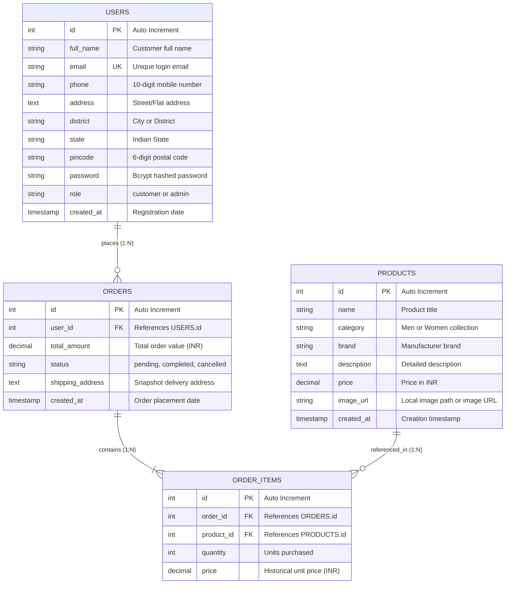

> Update: `order_items` now also has a nullable `size VARCHAR(3)` column for S, M, L, XL and XXL. Existing columns and relationships are retained.

# The Cloth Hub — Database Architecture & ER Diagram Documentation

This document outlines the complete relational database design, data dictionary, integrity constraints, and Entity-Relationship (ER) diagram for the **The Cloth Hub** clothing e-commerce platform.

---

## 1. Entity-Relationship (ER) Diagram

---

## 2. Table Specifications & Data Dictionary

### Table 1: `users`
Stores customer and administrator profile details, authentication credentials, and saved shipping destinations.

| Column Name | Data Type | Nullable | Key | Default | Description |
| :--- | :--- | :--- | :--- | :--- | :--- |
| `id` | `INT(11)` | No | **PK** | `AUTO_INCREMENT` | Unique identifier for each account |
| `full_name` | `VARCHAR(100)` | No | | `None` | Full name of the user |
| `email` | `VARCHAR(100)` | No | **UK** | `None` | Unique email used for authentication |
| `phone` | `VARCHAR(20)` | Yes | | `NULL` | 10-digit primary mobile contact number |
| `address` | `TEXT` | Yes | | `NULL` | Flat / House No., Building, Street |
| `district` | `VARCHAR(100)` | Yes | | `NULL` | City / District name |
| `state` | `VARCHAR(100)` | Yes | | `NULL` | Indian State / Union Territory |
| `pincode` | `VARCHAR(10)` | Yes | | `NULL` | 6-digit postal PIN code |
| `password` | `VARCHAR(255)` | No | | `None` | Secure Bcrypt-hashed password string |
| `role` | `ENUM('customer','admin')` | Yes | | `'customer'` | Access control level |
| `created_at` | `TIMESTAMP` | No | | `CURRENT_TIMESTAMP` | Account creation timestamp |

---

### Table 2: `products`
Houses ten sample clothing products: five for men and five for women, with prices and local illustrations.

| Column Name | Data Type | Nullable | Key | Default | Description |
| :--- | :--- | :--- | :--- | :--- | :--- |
| `id` | `INT(11)` | No | **PK** | `AUTO_INCREMENT` | Unique product ID |
| `name` | `VARCHAR(200)` | No | | `None` | Display title of the clothing product |
| `category` | `VARCHAR(50)` | No | | `None` | Men or Women |
| `brand` | `VARCHAR(50)` | No | | `None` | The Cloth Hub |
| `description` | `TEXT` | No | | `None` | Fabric, fit, colour and sample size |
| `price` | `DECIMAL(10,2)` | No | | `None` | Retail price in INR |
| `image_url` | `VARCHAR(255)` | Yes | | `'placeholder.png'` | Local image path or remote image URL |
| `created_at` | `TIMESTAMP` | No | | `CURRENT_TIMESTAMP` | Catalog entry timestamp |

---

### Table 3: `orders`
Tracks customer orders, snapshot shipping addresses, billing totals, and fulfillment status.

| Column Name | Data Type | Nullable | Key | Default | Description |
| :--- | :--- | :--- | :--- | :--- | :--- |
| `id` | `INT(11)` | No | **PK** | `AUTO_INCREMENT` | Unique order reference number |
| `user_id` | `INT(11)` | No | **FK** | `None` | ID of the customer who placed the order (`users.id`) |
| `total_amount` | `DECIMAL(10,2)` | No | | `None` | Total billable amount in INR |
| `status` | `ENUM('pending','completed','cancelled')` | Yes | | `'pending'` | Current fulfillment stage |
| `shipping_address` | `TEXT` | No | | `None` | Complete destination address captured at checkout |
| `created_at` | `TIMESTAMP` | No | | `CURRENT_TIMESTAMP` | Order timestamp |

---

### Table 4: `order_items`
Bridge table capturing the individual products and quantities included in an order, preserving historical purchase pricing.

| Column Name | Data Type | Nullable | Key | Default | Description |
| :--- | :--- | :--- | :--- | :--- | :--- |
| `id` | `INT(11)` | No | **PK** | `AUTO_INCREMENT` | Unique line-item ID |
| `order_id` | `INT(11)` | No | **FK** | `None` | References `orders.id` (Parent order) |
| `product_id` | `INT(11)` | No | **FK** | `None` | References `products.id` (Purchased item) |
| `quantity` | `INT(11)` | No | | `None` | Units ordered (1 to 10) |
| `price` | `DECIMAL(10,2)` | No | | `None` | Locked-in unit price at time of purchase in INR |

---

## 3. Relational Constraints & Cascade Rules

| Constraint Name | Source Table | Foreign Key | Target Table | Target Key | Cascade Rule |
| :--- | :--- | :--- | :--- | :--- | :--- |
| `fk_orders_user` | `orders` | `user_id` | `users` | `id` | `ON DELETE CASCADE` |
| `fk_orderitems_order` | `order_items` | `order_id` | `orders` | `id` | `ON DELETE CASCADE` |
| `fk_orderitems_product` | `order_items` | `product_id` | `products` | `id` | `ON DELETE CASCADE` |

---

## 4. Key Architectural Highlights

1. **Normalized Design (3NF)**: Redundancy is minimized while maintaining complete relational consistency between users, catalog items, and cart transactions.
2. **Indian Address Integration**: The `users` table accommodates full Indian postal logistics (`phone`, `address`, `district`, `state`, `pincode`) enabling checkout address prefilling.
3. **Decoupled Pricing**: Decoupled `price` columns in `products` vs `order_items` ensure that seasonal sales or updates never distort historical receipts.
