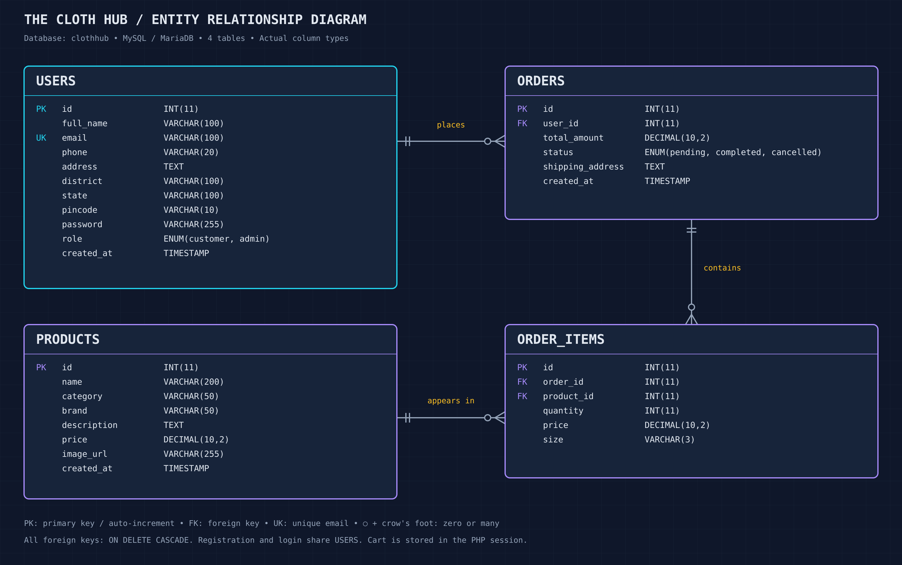

# The Cloth Hub database structure

Database: `clothhub` — **4 tables**. Verified from the running database.

| Table | Purpose | Columns |
|---|---|---|
| users | Customers and administrators | 11 |
| products | Clothing catalogue | 8 |
| orders | Order totals, status and delivery address | 6 |
| order_items | Products, quantities, prices and sizes in each order | 6 |

## users

| Column | Type | Nullable | Key | Default | Extra |
|---|---|---|---|---|---|
| id | int(11) | NO | Primary key | NULL | auto_increment |
| full_name | varchar(100) | NO | — | NULL | — |
| email | varchar(100) | NO | Unique | NULL | — |
| phone | varchar(20) | YES | — | NULL | — |
| address | text | YES | — | NULL | — |
| district | varchar(100) | YES | — | NULL | — |
| state | varchar(100) | YES | — | NULL | — |
| pincode | varchar(10) | YES | — | NULL | — |
| password | varchar(255) | NO | — | NULL | — |
| role | enum('customer','admin') | YES | — | customer | — |
| created_at | timestamp | NO | — | current_timestamp() | — |

## products

| Column | Type | Nullable | Key | Default | Extra |
|---|---|---|---|---|---|
| id | int(11) | NO | Primary key | NULL | auto_increment |
| name | varchar(200) | NO | — | NULL | — |
| category | varchar(50) | NO | — | NULL | — |
| brand | varchar(50) | NO | — | NULL | — |
| description | text | NO | — | NULL | — |
| price | decimal(10,2) | NO | — | NULL | — |
| image_url | varchar(255) | YES | — | placeholder.png | — |
| created_at | timestamp | NO | — | current_timestamp() | — |

## orders

| Column | Type | Nullable | Key | Default | Extra |
|---|---|---|---|---|---|
| id | int(11) | NO | Primary key | NULL | auto_increment |
| user_id | int(11) | NO | Indexed / foreign key | NULL | — |
| total_amount | decimal(10,2) | NO | — | NULL | — |
| status | enum('pending','completed','cancelled') | YES | — | pending | — |
| shipping_address | text | NO | — | NULL | — |
| created_at | timestamp | NO | — | current_timestamp() | — |

## order_items

| Column | Type | Nullable | Key | Default | Extra |
|---|---|---|---|---|---|
| id | int(11) | NO | Primary key | NULL | auto_increment |
| order_id | int(11) | NO | Indexed / foreign key | NULL | — |
| product_id | int(11) | NO | Indexed / foreign key | NULL | — |
| quantity | int(11) | NO | — | NULL | — |
| price | decimal(10,2) | NO | — | NULL | — |
| size | varchar(3) | YES | — | NULL | — |

## Relationships

- `orders.user_id` → `users.id`
- `order_items.order_id` → `orders.id`
- `order_items.product_id` → `products.id`

All three foreign keys use `ON DELETE CASCADE`. All four `id` columns auto-increment. `order_items.size` stores S, M, L, XL or XXL; older orders may have NULL.

The cart lives in the PHP session, so there is no cart table. Registration and login both use the users table.

## ER diagram

[Editable SVG](IMG/er-diagram.svg) · [Mermaid source](IMG/er-diagram.mmd)

Registration and login both use `users`; no additional authentication tables are created.
